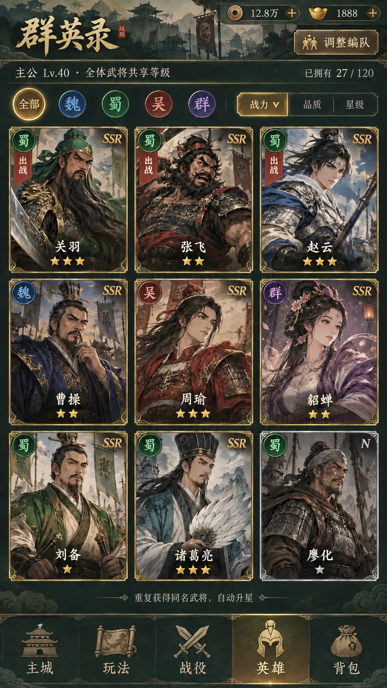
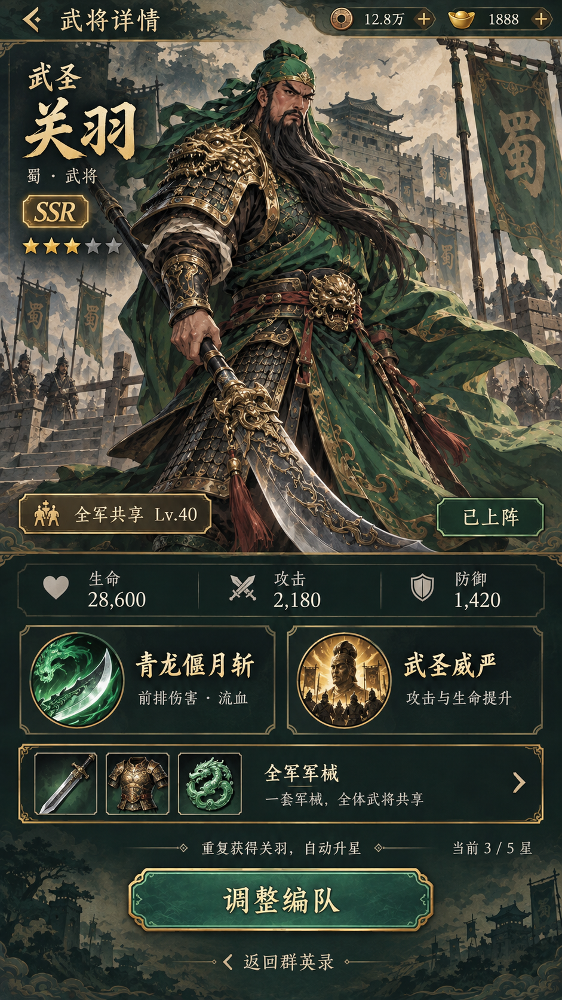

# 群英录与武将详情 · 视觉原型 v1

日期：2026-09-27。用于审阅布局、美术与信息层级，未修改 Cocos 或旧 Canvas 运行界面；不代表玩法、数值或资源验收。

## 设计方向

参考项目内《剑与远征》三轮体验记录的英雄列表／筛选／详情层级；角色、纹样和界面重新设计为三国题材。墨绿漆木、铜金细框、浅色绢纸与水墨城关作为共同视觉语言。英雄卡片以清楚的大立绘为主，不堆叠培养按钮。

- 列表：资源 → 群英录与编队 → 统一等级及收集数量 → 阵营筛选与排序 → 三列武将卡 → 自动升星提示 → 五栏导航。
- 详情：返回 → 大立绘与姓名／阵营／职业／品质／星级 → 共享等级与上阵状态 → 关键属性 → 两个现有技能 → 全军军械入口 → 调整编队。
- 品质用白／蓝／紫／橙卡框；阵营用独立图徽与文字。列表样例以 SSR 为主，N 廖化用于展示低品质框。星级不与品质混称。
- 全体武将共享主公等级；重复卡自动升星。无个人升级、手动升星或个人穿戴槽。
- 关羽技能取现有配置：青龙偃月斩、武圣威严；属性数值、持有数量、等级及星数仅是演示数据，不改游戏配置。

## 原型图

### 群英录


### 关羽详情


## 交互约定（待实现）

1. 点击魏／蜀／吴／群筛选，全部恢复完整列表；排序支持战力、品质、星级。
2. 点击英雄卡进入详情，返回时保留筛选和滚动位置。
3. 详情点击技能查看完整说明；点击全军军械进入共享图鉴。
4. 已上阵英雄显示“调整编队”；选择空位／替换武将由编队页处理，不直接把最高战力视为最佳阵容。
5. 空阵营状态可提供前往召唤入口。未拥有英雄不显示虚构养成状态。
6. 后续使用 Cocos 原生节点、ScrollView、Sprite 与 Label 落地；文字和点击区域应由组件重建，不把整张 UI 图当作运行时按钮。

## 素材与验证边界

使用内置 ImageGen（imagegen skill），图片是高保真视觉样稿。人物立绘嵌入在图中，尚未拆为透明立绘、图集、九宫格边框或技能图标；若方向确认，下一步再按 Cocos 资源规格拆分生成。没有把图导入 assets/，没有动游戏存档。

核对中文、阵营、卡片层级与既有培养规则；本轮不涉及运行代码，因此不执行游戏构建或玩法回归。图中细小字体与触摸目标尺寸仍需落地到真实手机后验证。

## 完整生成提示词

### 群英录初稿
```text
Use case: ui-mockup.
Create one high fidelity PORTRAIT 9:16 mobile game HERO ROSTER UI prototype, full bleed screenshot, no device frame, no outside presentation board. Original Chinese Three Kingdoms idle card RPG, Chinese title "群英录". Borrow the clear collection grid information hierarchy of AFK Arena, but all characters, portraits, ornaments and art must be original Three Kingdoms designs, not copied game assets.
Art direction: sophisticated illustrated storybook, confident dark ink contours, matte gouache painted angular shapes, elegant stylized faces with distinctive silhouettes, not photorealistic or chibi. Restrained Han dynasty bronze fittings, parchment paper, deep jade lacquer, pale warm gold, subtle cloud relief; dramatic attractive hero artwork dominates 65 percent of the screen. Clean practical mobile UI, not a web dashboard.
Layout in order:
Top slim dark jade resource strip, copper coin "12.8万" and gold ingot "1888".
Title row "群英录" left in readable brush-inspired display type, a compact bronze button "调整编队" right.
Slim shared-level band exactly "主公 Lv.40 · 全体武将共享等级". Small collection count "已拥有 27 / 120".
Faction filter row with five distinct circular medallions and readable labels "全部" "魏" "蜀" "吴" "群"; 全部 selected gold. Filters secondary to portraits.
Small sorting row "战力" "品质" "星级", 战力 selected.
Center/lower body: EXACTLY 3 columns by 3 rows of large tall hero portrait cards, evenly spaced, substantial portrait area, thin restrained gilded corners, readable single-line hero names, rarity letters in small top right corner, stars separated clearly beneath names. No massive header, no large blank areas.
Nine portraits in row-major order:
1 "关羽" SSR: proud mature warrior, long flowing black beard, green robe over bronze lamellar armor, green headwrap, glimpse of crescent guandao.
2 "张飞" SSR: muscular broad face, black beard, dark armor, red sash, fierce eyebrows.
3 "赵云" SSR: handsome clean-shaven young male, white/silver Han armor, blue cloak, spear.
4 "曹操" SSR: mature cunning male, trimmed black beard, dark blue robes, golden crown.
5 "周瑜" SSR: refined young male commander, vermilion armor, elegant red cloak.
6 "貂蝉" SSR: dignified adult woman, violet and ivory flowing Han attire, elaborate hairpin, no sexualized costume.
7 "刘备" SSR: warm composed middle-aged male, green and cream robes, twin sword hilts.
8 "诸葛亮" SSR: elegant male strategist with scholar cap, white feather fan and teal robe.
9 "廖化" N: weathered soldier, simple gray/brown armor and headwrap; silver-white rarity border.
First eight have subdued bronze-gold SSR borders, last silver gray border, faction insignia separately colored blue/green/red/violet so rarity and faction are NOT confused. First three small "出战" corner ribbons. Give cards varied 0–3 stars, no per-hero level numbers because level is shared. All text concise legible Simplified Chinese. Portraits must be dramatically different, not nine variations of the same face.
A tiny helper line below grid "重复获得同名武将，自动升星".
Bottom fixed five-tab bar, clear illustrated icons and labels "主城" "玩法" "战役" "英雄" "背包"; 英雄 active gold.
Constraints: meaningful typographic hierarchy, consistent touch targets, calm readable background; no personal upgrade button, no equipment slots on cards, no red-dot spam, no VIP, no paywall or purchase buttons, no unrelated logos. Polished coherent shippable-looking UI art direction prototype.
```

### 阵营标记校正
```text
Use case: precise-object-edit. Edit the provided hero roster UI image. Preserve the entire composition, every portrait, all typography, all card positions, all borders and all other labels exactly. ONLY correct two faction medallions: the top-middle card 张飞 currently has a red 吴 medallion; replace it with a GREEN 蜀 medallion matching the green medallion on 关羽. The bottom-right 廖化 card currently has a gray 群 medallion; replace ONLY that faction medallion with the same GREEN 蜀 medallion. Keep 廖化 N rarity and his silver-white card border unchanged. Do not change either hero portrait. No other changes.
```

### 关羽详情
```text
Use case: ui-mockup.
Use the supplied image as STYLE AND CHARACTER reference only. Create the matching second screen of this ORIGINAL Three Kingdoms mobile card game: the HERO DETAIL screen for 关羽, portrait 9:16 full bleed screenshot, no phone frame or presentation board. Match the source's dark jade lacquer, warm ivory parchment, fine bronze-gold fittings, ink-painted atmospheric landscape, high quality illustrated character and readable Simplified Chinese. Retain the SAME Guan Yu face, long black beard, green headwrap, green cloth over bronze dragon lamellar armor from the top-left card. Expand him into an imposing ORIGINAL full-body illustrated warrior with flowing green robe, crescent guandao blade and controlled heroic pose, excellent hands/anatomy. Do not reproduce the roster grid.
Mobile screen hierarchy:
Top narrow header contains back chevron and exact label "武将详情", subtle resources "12.8万" and "1888".
Upper 52 percent dominated by Guan Yu full-body illustration in a misty Han fortress courtyard with banners. Calm background, no busy interface boxes over face. Near upper left: elegant small epithet "武圣", large display name "关羽", smaller line "蜀 · 武将", restrained SSR bronze-gold badge. Under the identity 3 gold stars plus 2 dim star outlines, meaning three of five stars. Near lower edge of portrait, a compact plaque "全军共享 Lv.40" and clear "已上阵" badge.
Lower half: readable layered parchment and dark jade information panels, generously spaced rather than spreadsheet.
One slim three-column stats row with sample values: "生命 28,600", "攻击 2,180", "防御 1,420".
Two skill tiles side by side with original illustrated round icons: crescent blade jade sweep and bronze warrior seal. Exact labels "青龙偃月斩" with short helper "前排伤害 · 流血"; "武圣威严" with helper "攻击与生命提升". Only TWO skills, do not invent extra slots.
A single horizontal shared-equipment entry: three small illustrated sword/armor/jade icons on the left, text "全军军械" then smaller "一套军械，全体武将共享", and a clear chevron on the right. NO personal gear slots around the character.
A slim informational line "重复获得关羽，自动升星" above primary action, plus small "当前 3 / 5 星".
Bottom one broad prominent jade-teal action button with bronze edge "调整编队". Smaller text link "返回群英录". This is a subpage with BACK navigation, so no 5-tab global nav here.
Constraints: original Three Kingdoms historical fantasy artwork; impressive full-body hero; confident simple strokes and painted surface compatible with the reference. Legible and exact Chinese labels, refined light/dark balance, no photoreal photo/3D. No individual level-up button, no ascend/upgrade button, no personal equipment, no new currencies, no VIP, no purchasable costumes, no external logos. Sample statistics are only visual prototype numbers.
```
